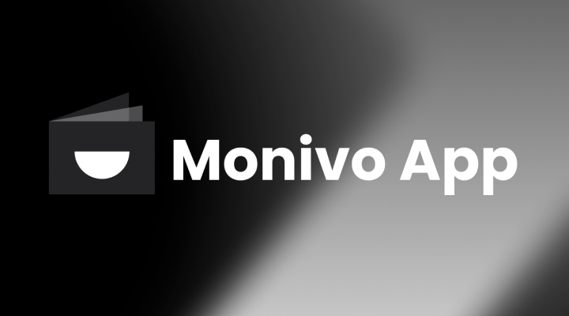
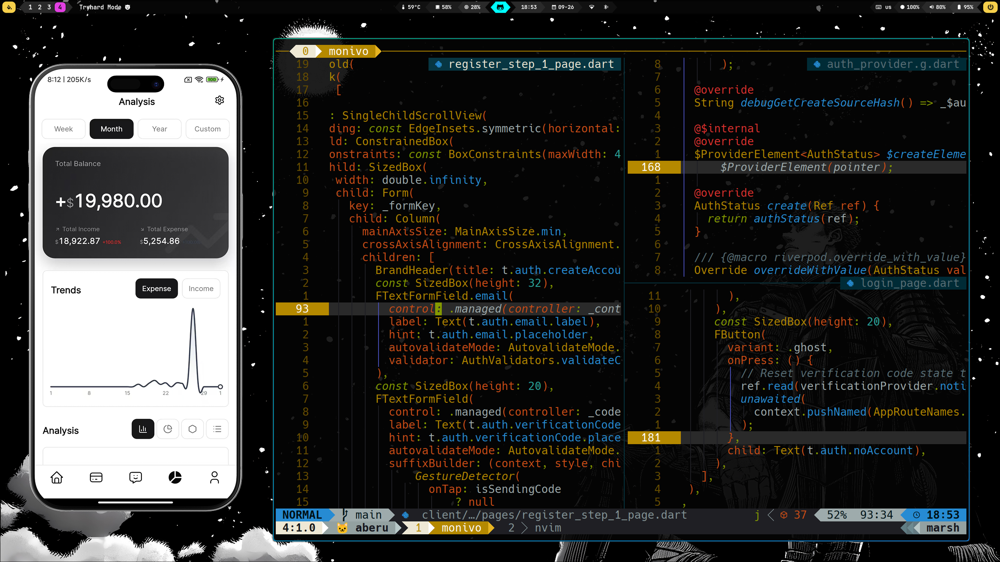
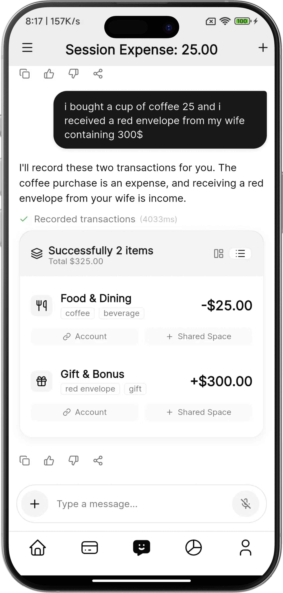
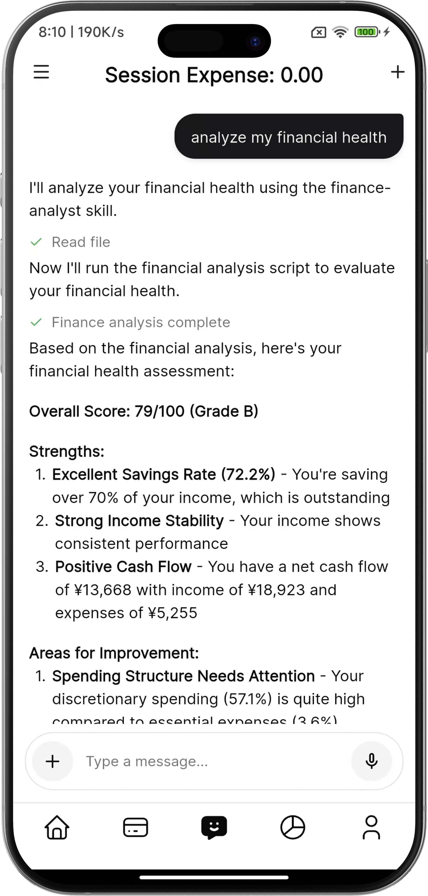
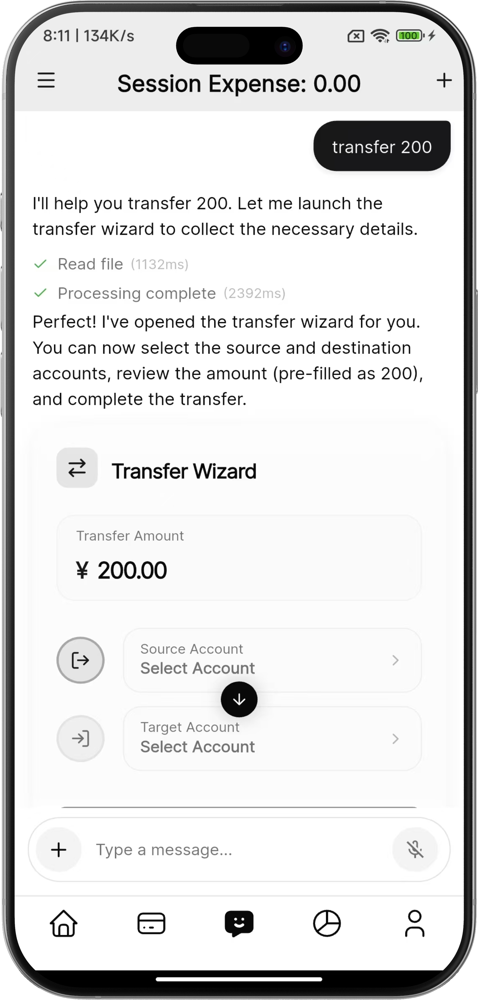

  <strong>English</strong> · <a href="./README_ZH.md">简体中文</a>

  

  <strong>Personal finance, made conversational.</strong> 
  An open-source, self-hosted finance assistant that helps you record transactions, understand spending, and stay on top of your money with AI.

  
  
  
  
  

  

  <a href="#features">Features</a> ·
  <a href="#architecture">Architecture</a> ·
  <a href="#getting-started">Getting started</a> ·
  <a href="#documentation">Documentation</a>

---

## Monivo in action

  

  A closer look at Monivo running alongside its development environment.

Rather than switching between spreadsheets, forms, and dashboards, Monivo brings everyday money management into a conversation. Log an expense in natural language, explore your finances through interactive results, and keep control of where your data lives.

### Inside the app

  
  
  

  Conversational bookkeeping · Financial insights · Extensible skills · Transfers

## Features

- **Natural-language bookkeeping.** Record income and expenses by describing them as you would in a message. The agent can interpret transaction details and help organize your ledger.
- **Interactive financial insights.** Explore spending, budgets, and trends through conversational responses and dynamically rendered UI components powered by A2UI and ForUI.
- **Voice input on your terms.** Use device speech recognition or opt into a self-hosted ASR service for private speech-to-text processing.
- **Shared finances.** Work with shared ledgers, multi-member spaces, transfers, and budgeting features.
- **Agent memory and skills.** LangGraph orchestration, contextual memory, and modular Python skills support richer financial workflows.
- **Self-hosted by design.** Run the application and its database on infrastructure you control, with a choice of local or cloud language models.

## Architecture

Monivo connects a Flutter client to a Python API and an AI agent. The backend handles financial operations, persistence, contextual memory, and integrations.

~~~mermaid
flowchart LR
    A["Flutter app ForUI + A2UI"] <--> B["FastAPI"]
    B <--> C["LangGraph agent Memory + skills"]
    C <--> D[("PostgreSQL pgvector")]
    C <--> E["Local or cloud LLM"]
    B <--> F[("Redis")]
    A -. "Optional voice input" .-> G["Device speech or self-hosted ASR"]
~~~

| Layer | Technologies |
| :--- | :--- |
| Mobile client | Flutter, Dart, ForUI, A2UI |
| API and agent | Python 3.13, FastAPI, LangGraph |
| Memory and storage | Mem0, PostgreSQL, pgvector, Redis |
| Language models | Configurable cloud providers or local Ollama |
| Deployment | Docker Compose, uv, Make |

## Getting started

**Prerequisites:** Docker with Compose, plus an LLM provider key or a configured local Ollama endpoint.

1. Clone the repository.

   ~~~bash
   git clone https://github.com/4beru/monivo.git
   cd monivo
   ~~~

2. Create your backend environment file and configure the database credentials, model provider, and other required settings.

   ~~~bash
   cp server/.env.example server/.env
   ~~~

3. Start the stack.

   ~~~bash
   make docker-up
   ~~~

   The Makefile also displays a pairing QR code. Use the Flutter app to connect to your running backend.

To run the Flutter client from source:

~~~bash
cd client
flutter pub get
flutter run
~~~

**Optional self-hosted speech recognition:** From the repository root, start the voice profile with:

~~~bash
docker compose --profile voice up -d
~~~

The service is exposed on host port **8081**. See the in-app speech recognition settings to configure the endpoint. Without the optional service, the app can use device speech recognition.

> [!IMPORTANT]
> Before exposing Monivo to the internet, replace example secrets, set up real authentication delivery providers, restrict registration as appropriate, and review the [production deployment checklist](./docs/deploy.md). Self-hosting the database does not make requests to a *cloud* LLM private or offline; use a local model when that distinction matters.

## Project structure

~~~text
monivo/
├── client/                 # Flutter client and visual assets
├── server/                 # FastAPI, LangGraph, services and skills
├── docs/                   # Deployment and development guides
├── docker-compose.yml      # Self-hosted services and optional profiles
├── Makefile                # Common development and lifecycle commands
└── LICENSE                 # AGPL-3.0
~~~

## Documentation

- [Production deployment checklist](./docs/deploy.md)
- [Contributing guide](./CONTRIBUTING.md)
- [Changelog](./CHANGELOG.md)
- [Unit testing guide](./docs/unit-testing-guide_EN.md)

## Acknowledgements & license

Monivo builds on the open-source [Finvo](https://github.com/kylesean/Finvo) project. The optional local speech recognition integration uses [asr_server](https://github.com/kylesean/asr_server). Credit belongs to their respective contributors.

This repository is distributed under the [GNU Affero General Public License v3.0](./LICENSE).

  

Monivo · An open-source approach to everyday finance.

