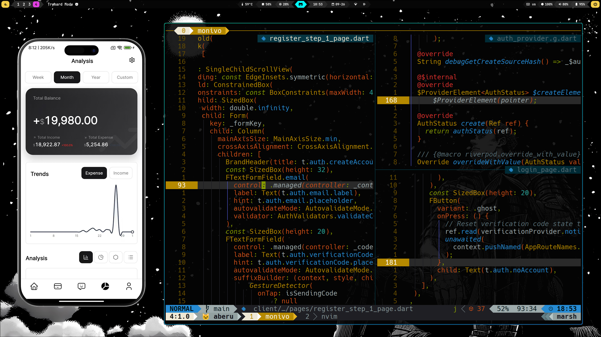
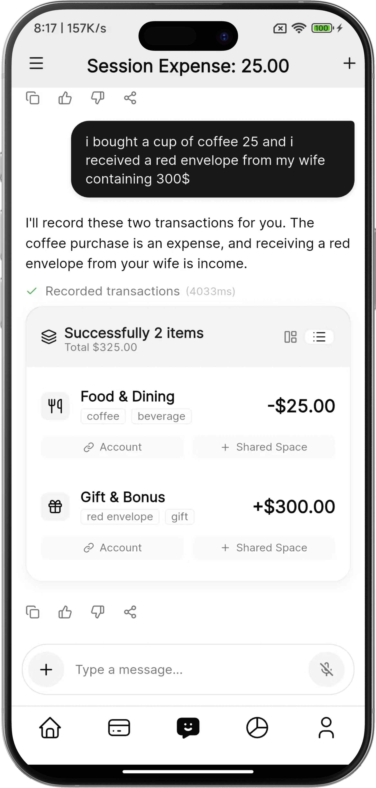
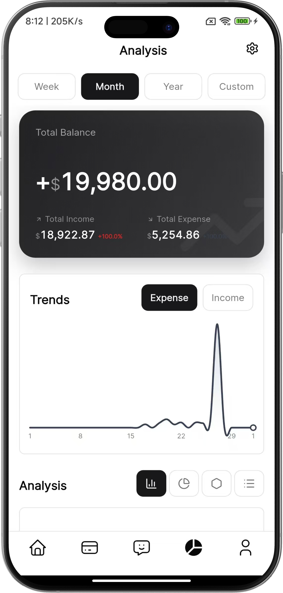
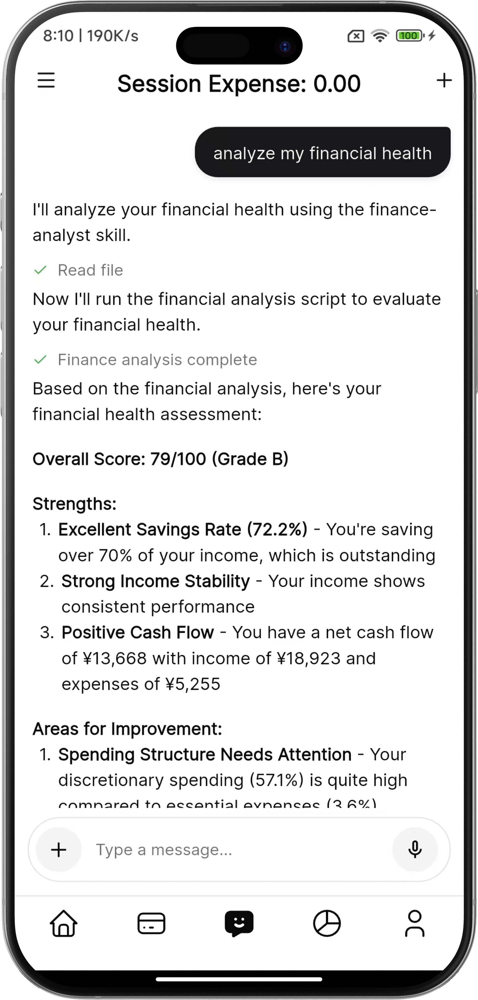
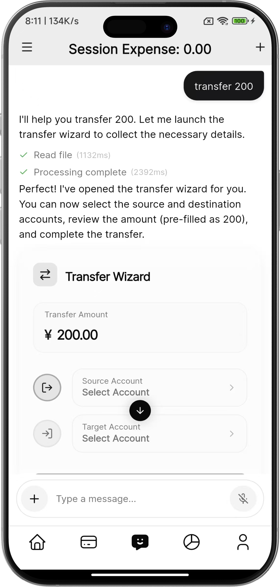

  <a href="./README.md">English</a> · <strong>简体中文</strong>

  

  <strong>用对话，轻松管理个人财务。</strong> 
  Monivo 是一款开源、支持私有化部署的 AI 财务助手，让记账、消费分析和日常资金管理更加直观。

  
  
  
  
  

  <a href="#核心功能">核心功能</a> ·
  <a href="#系统架构">系统架构</a> ·
  <a href="#快速开始">快速开始</a> ·
  <a href="#相关文档">相关文档</a>

---

## Monivo 运行展示

  

Monivo 应用与开发环境的实际运行画面。

Monivo 将日常财务管理融入自然语言对话：你可以直接记录收支，通过交互式分析了解消费情况，并自行决定应用和数据的部署位置。

### 应用界面

  
  
  
  

对话记账 · 财务洞察 · 技能扩展 · 转账管理

## 核心功能

- **自然语言记账：** 像聊天一样描述收入或支出，AI Agent 帮助提取交易信息并整理账目。
- **交互式财务分析：** 通过对话查看消费趋势、预算与财务数据；使用 A2UI 和 ForUI 动态呈现交互组件。
- **灵活的语音输入：** 可使用设备语音识别，也可以选择自托管 ASR 服务处理语音。
- **共享财务管理：** 支持多人空间、共享账本、预算与转账等功能。
- **Agent 记忆与技能：** 使用 LangGraph、上下文记忆及模块化 Python Skills 扩展财务工作流。
- **自主部署：** 在自己的基础设施上部署应用与数据库，按需求连接本地或云端语言模型。

## 系统架构

Monivo 使用 Flutter 构建客户端，FastAPI 提供后端接口，并由 LangGraph Agent 组织财务操作、上下文记忆和技能调用。

~~~mermaid
flowchart LR
    A["Flutter 客户端 ForUI + A2UI"] <--> B["FastAPI"]
    B <--> C["LangGraph Agent 记忆 + Skills"]
    C <--> D[("PostgreSQL pgvector")]
    C <--> E["本地 / 云端 LLM"]
    B <--> F[("Redis")]
    A -. "可选语音输入" .-> G["设备语音识别 或自托管 ASR"]
~~~

| 模块 | 技术 |
| :--- | :--- |
| 移动客户端 | Flutter、Dart、ForUI、A2UI |
| API 与智能体 | Python 3.13、FastAPI、LangGraph |
| 记忆与存储 | Mem0、PostgreSQL、pgvector、Redis |
| 语言模型 | 云端模型服务或本地 Ollama |
| 部署与开发 | Docker Compose、uv、Make |

## 快速开始

**准备工作：** 安装 Docker 和 Docker Compose，并准备语言模型 API Key 或本地 Ollama 服务。

1. 克隆仓库。

   ~~~bash
   git clone https://github.com/4beru/monivo.git
   cd monivo
   ~~~

2. 复制配置文件，设置数据库密码、模型服务及所需环境变量。

   ~~~bash
   cp server/.env.example server/.env
   ~~~

3. 启动服务。

   ~~~bash
   make docker-up
   ~~~

   启动命令还会生成配对二维码，可使用 Flutter 客户端连接后端。

如需从源码运行 Flutter 客户端：

~~~bash
cd client
flutter pub get
flutter run
~~~

**可选的自托管语音识别：** 在仓库根目录执行：

~~~bash
docker compose --profile voice up -d
~~~

语音服务使用主机端口 **8081**，可在应用的语音识别设置中配置。不启用该服务时，应用也可以使用设备自带的语音识别。

> [!IMPORTANT]
> 公开部署前，请更新默认密钥、配置真实的身份验证消息服务，并根据需要限制注册。详细要求参见[生产部署清单](./docs/deploy.md)。使用云端语言模型时，相关请求仍会发送给模型提供方；需要完整本地处理时应选择本地模型。

## 仓库结构

~~~text
monivo/
├── client/                 # Flutter 客户端与视觉资源
├── server/                 # FastAPI、LangGraph、服务和技能
├── docs/                   # 部署与开发文档
├── docker-compose.yml      # 自托管服务及可选配置
├── Makefile                # 常用开发和管理命令
└── LICENSE                 # AGPL-3.0
~~~

## 相关文档

- [生产部署清单](./docs/deploy.md)
- [贡献指南](./CONTRIBUTING.md)
- [更新日志](./CHANGELOG.md)
- [单元测试指南](./docs/unit-testing-guide.md)

## 致谢与许可证

Monivo 基于开源项目 [Finvo](https://github.com/kylesean/Finvo) 开发；可选的本地语音识别集成使用 [asr_server](https://github.com/kylesean/asr_server)。感谢原项目及相关贡献者。

本项目采用 [GNU Affero General Public License v3.0](./LICENSE) 许可证。

  

Monivo · 开源的日常财务管理方式。

